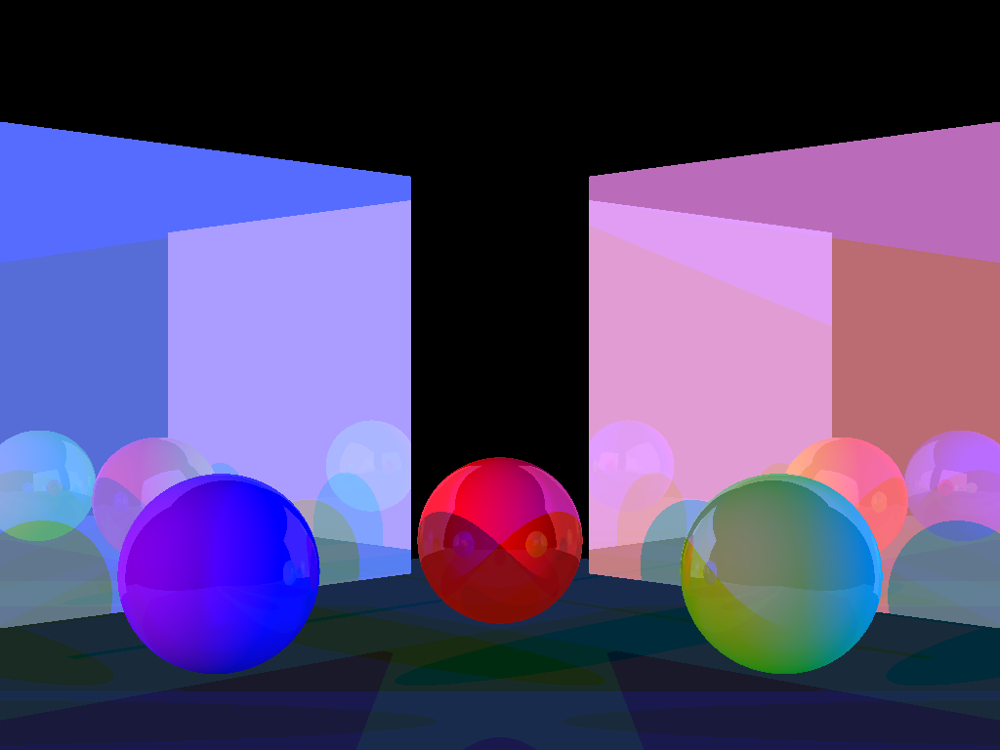
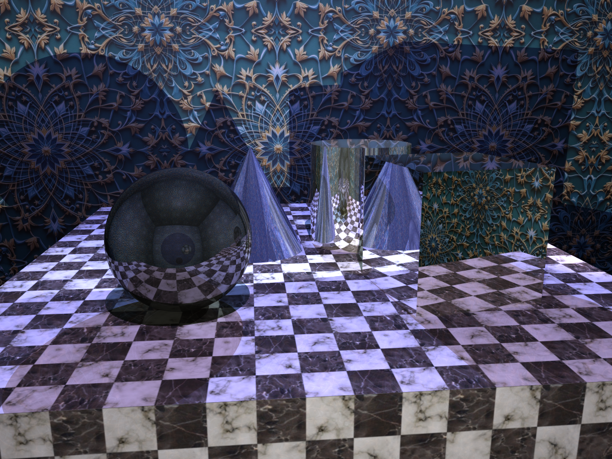
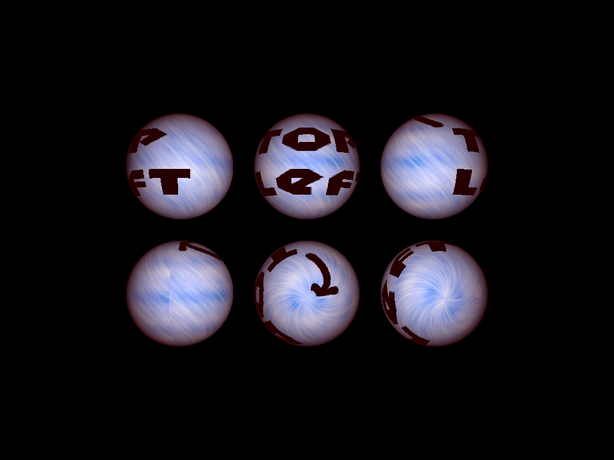
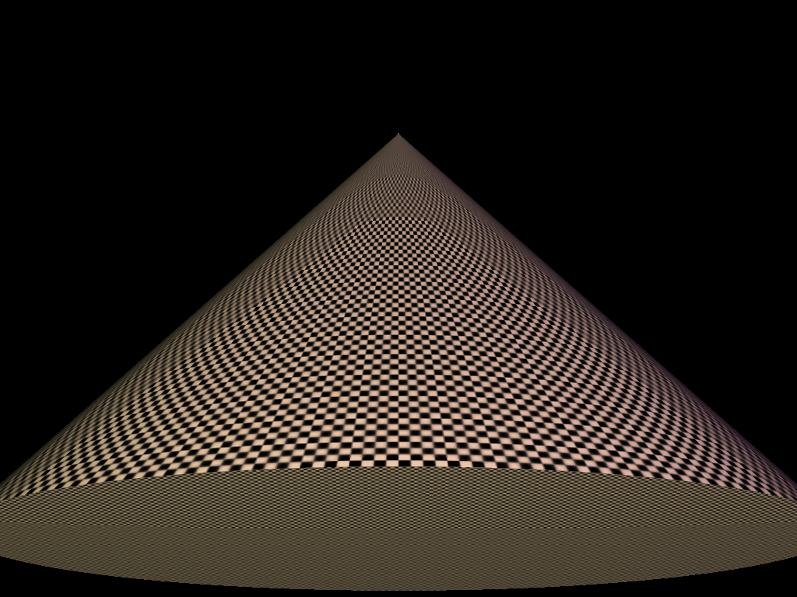
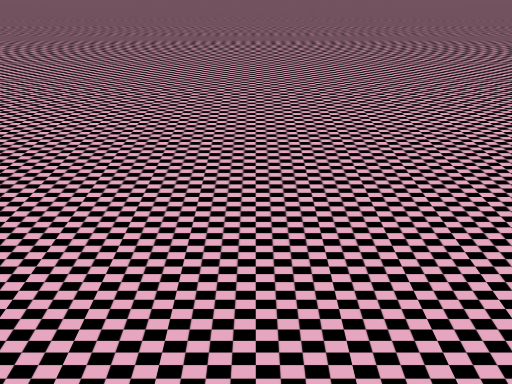
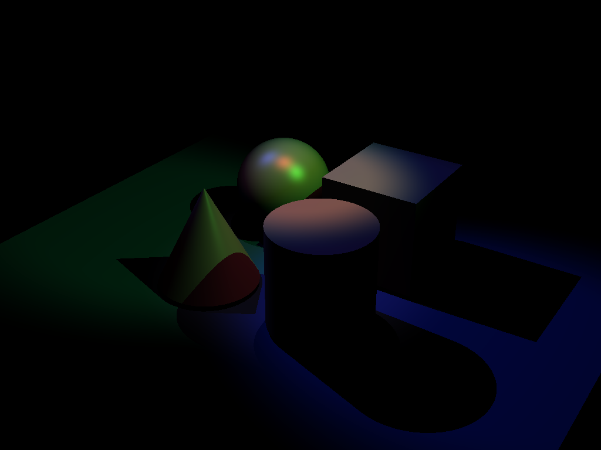
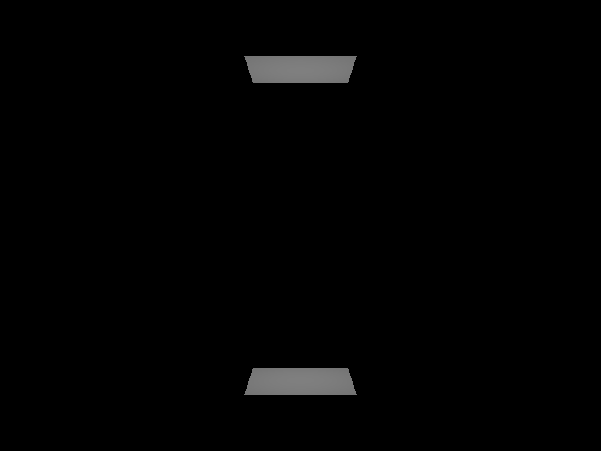
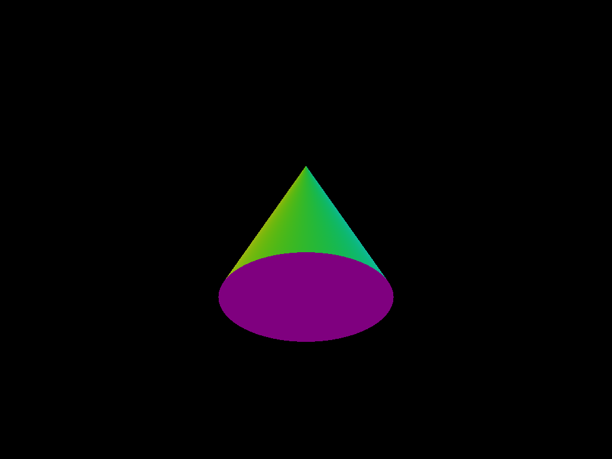
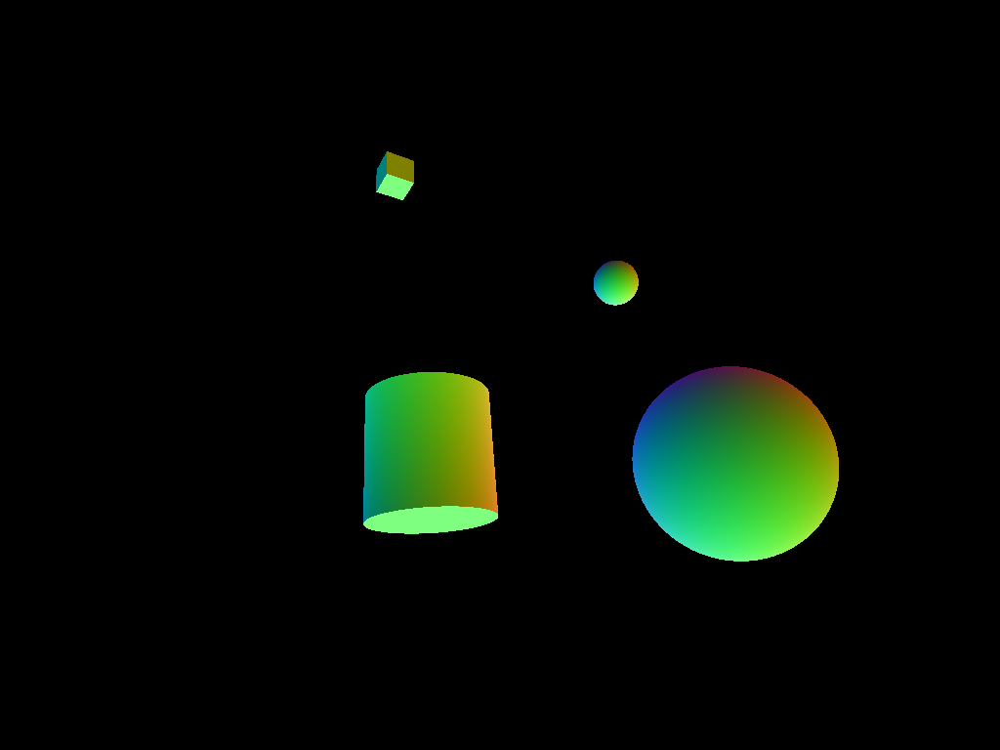

# Ray Tracer

A C++/Qt ray tracer built from scratch for Brown's CS 1230 (Computer Graphics), supporting recursive reflections, antialiasing, and texture filtering across 4 shape types and 3 light types.

Source code is kept private per course policy. This repo shows renders only.

## Features

- Recursive reflections up to 8 bounces deep
- Grid, random, and stratified supersampling (up to 64 samples/pixel)
- Bilinear and trilinear texture filtering
- 10-level mipmap pyramids with ray differentials for automatic detail selection
- Custom scene parser and camera view matrix
- 1024x768 renders, validated across 20 test scenes

## Renders

### Reflections

### Texture Filtering & Mipmapping

### Lighting

### Primitives

## Tech Stack

C++, Qt, GLM
