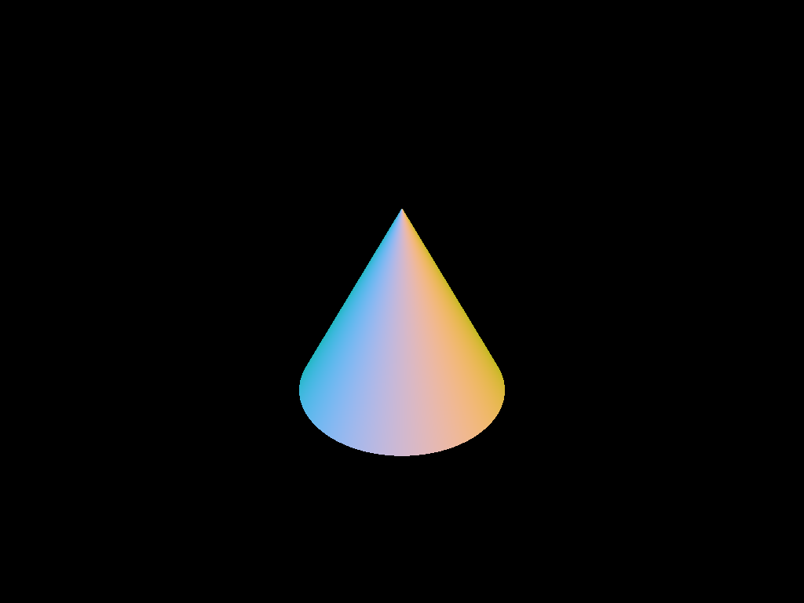
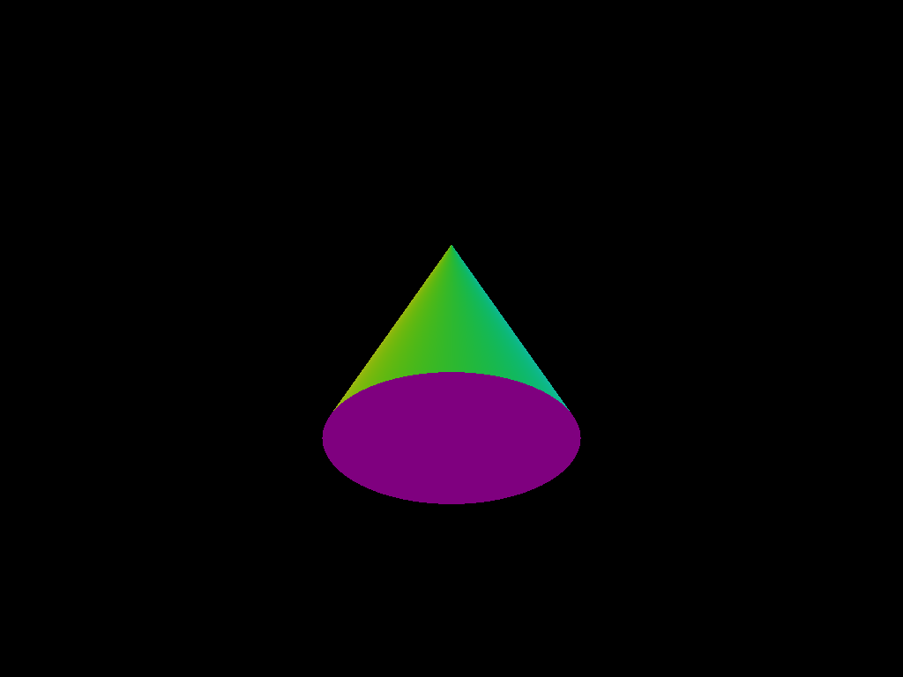
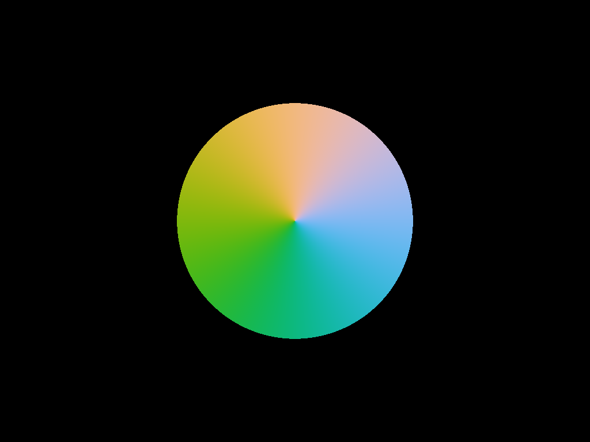
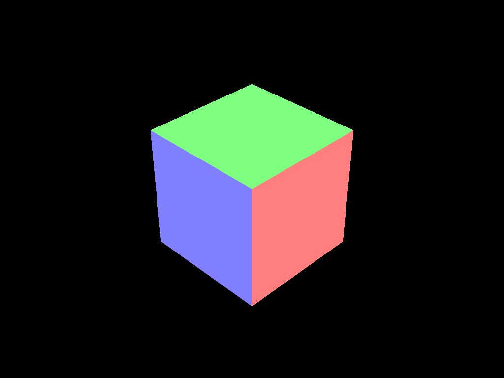
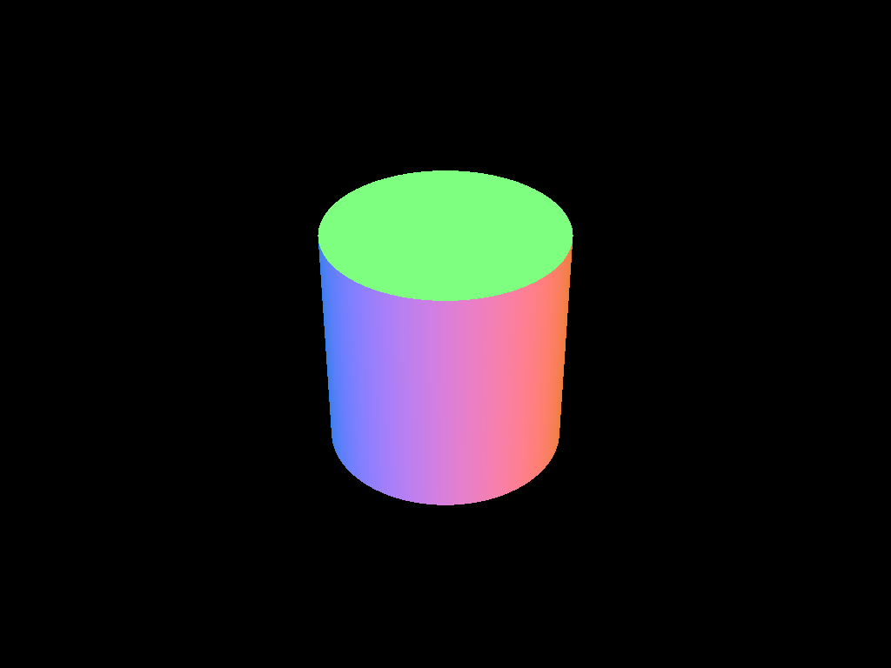
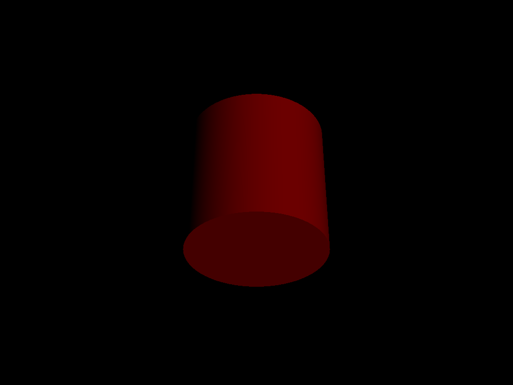
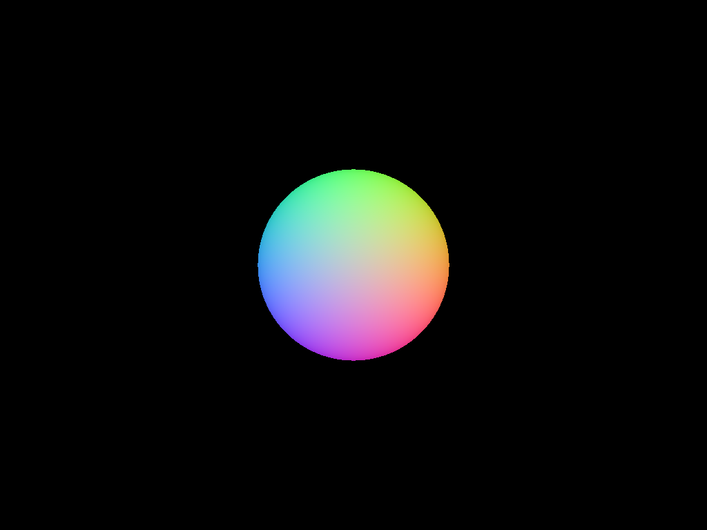
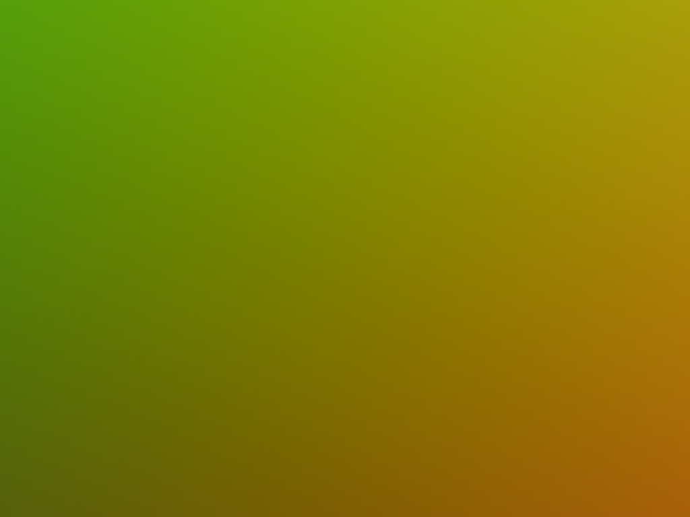
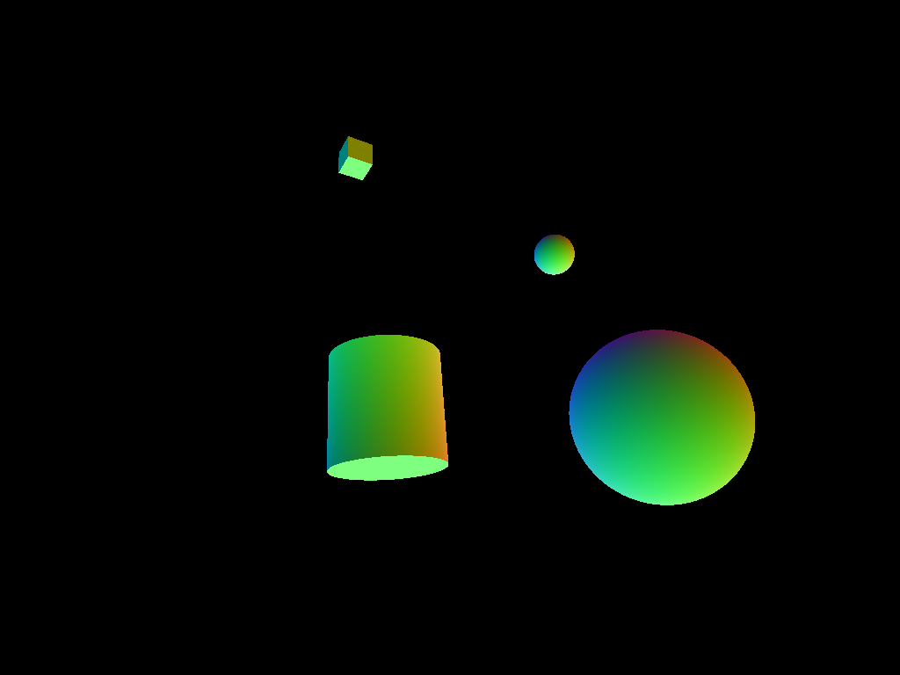
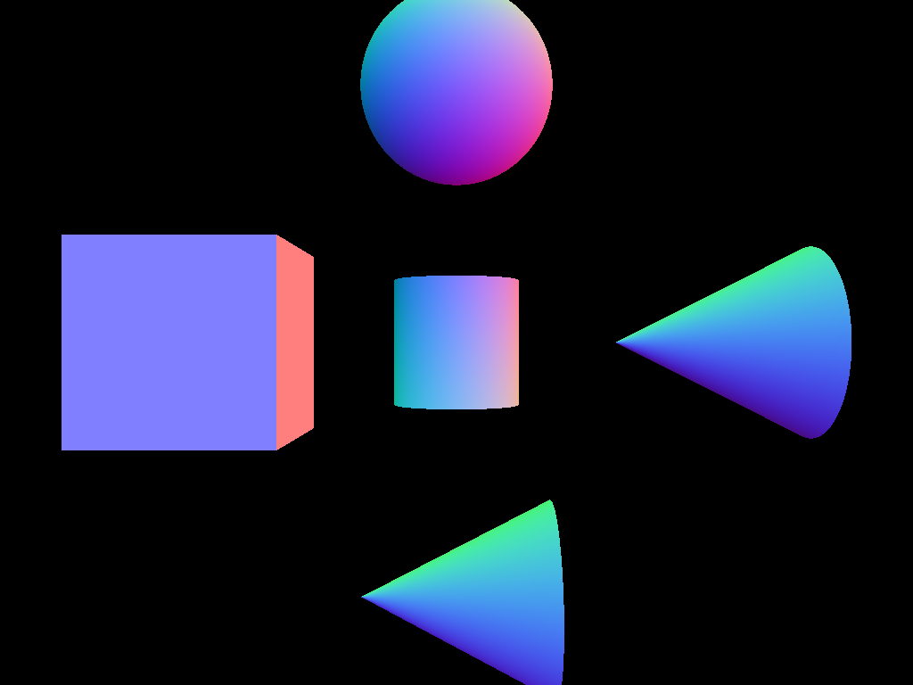

## Project 2: Intersect

Please fill this out for Intersect only. The project handout can be found [here](https://cs1230.graphics/projects/ray/1).

### Output Comparison

Run the program with the specified `.ini` file to compare your output (it should automatically save to the correct path).

> If your program can't find certain files or you aren't seeing your output images appear, make sure to: 
>
> 1. Set your working directory to the project directory
> 2. Set the command-line argument in Qt Creator to `template_inis/intersect/<ini_file_name>.ini`
> 3. Clone the `scenefiles` submodule. If you forgot to do this when initially cloning this repository, run `git submodule update --init --recursive` in the project directory

> Note: once all images are filled in, the images will be the same size in the expected and student outputs.

| File/Method To Produce Output |                                                           Expected Output                                                            |                                                             Your Output                                                              |
| :---------------------------: | :----------------------------------------------------------------------------------------------------------------------------------: | :----------------------------------------------------------------------------------------------------------------------------------: |
|         unit_cone.ini         |             |                 |
|       unit_cone_cap.ini       |         |         |
|       unit_cone_top.ini       |         |         |
|         unit_cube.ini         |             |                 |
|       unit_cylinder.ini       |         |         |
|   unit_cylinder_bottom.ini    |  |  |
|        unit_sphere.ini        |           |             |
|        unit_sphere_inside.ini        |           |             |
|       parse_matrix.ini        |          |           |
|           normal_total.ini           |          |                  |

### Design Choices
I created a Primitive abstract class for the shapes that let me create an intersect method that differed for each primitive. I also tried to minimize the amount of parameters to methods by keeping things as local as possible, specifically in Camera. I made things like converting between points or getting rays all within the camera class over the raytracing class. I also created three new structs: a ray that has a start point and a direction which is very helpful for determinin HitPoints, which was my second struct for determining at what value of t does a ray hit the shape and whats the normal from the surface it hits. I also created a CacheCTM struct to stop from recomputing the CTM at every intersection for a shape.

### Collaboration/References
N/A

### Known Bugs
N/A

### Extra Credit
N/A
